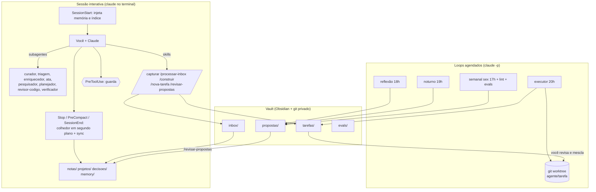

# Arquitetura

O kit é feito **só com o que o Claude Code já tem**: `CLAUDE.md`, hooks, subagentes, skills, `claude -p` (modo não interativo) e `git worktree`. O agendamento é o do sistema operacional. Não depende de nenhum app de orquestração (Orca, herdr, IDE de agentes). Esses apps podem ser usados por cima para ver os agentes em tela dividida, mas nada no kit precisa deles.

## Visão geral



## Sem ritual: o cérebro se mantém sozinho

Quem usa o Claude Code no dia a dia manda o prompt e segue. Por isso nada essencial depende de você lembrar de rodar alguma coisa (ADR 0008):

| Momento | O que acontece sozinho | Você faz |
|---|---|---|
| Durante a sessão | A cada ~8 turnos, antes de compactar o contexto e no fim da sessão, o **colhedor** lê o trecho novo da conversa em segundo plano e grava status de projeto, aprendizados, pessoas e tarefas | nada |
| Fim de cada turno | O **sync** faz commit e push do vault | nada |
| 19h | O **noturno** arquiva o que tem destino óbvio no inbox e enriquece notas marcadas | nada |
| Sexta 17h | O **semanal** conserta links, índices e frontmatter, revisa o que foi aplicado sozinho e escreve o resumo | ler o resumo, se quiser |
| Início de sessão | O Claude vê as propostas pendentes e, **depois da primeira tarefa**, oferece aprovar numa pergunta de múltipla escolha (no máximo 1x por dia) | um clique |

**O que é aplicado sozinho e o que vira proposta:**

| Aplica sozinho (baixo risco) | Vira proposta (muda comportamento ou é sensível) |
|---|---|
| status e próximos passos em `projetos/` | memória sobre você (preferência, correção) |
| anexos e notas novas em `notas/`, `referencias/`, `pessoas/`, `reunioes/` | ADR em `decisoes/` |
| itens no `inbox/`, tarefas em `rascunho` | agentes, skills, `CLAUDE.md`, prompts |
| links, `indice.md`, linhas do `MEMORY.md` | `config/`, `templates/`, `evals/`, apagar coisas |

A fronteira é garantida pela `guarda.ps1` (variável `CEREBRO_ESCRITA=auto`), não pelo prompt. Tudo vai para o git em commits separados e aparece na seção `## Aplicado automaticamente` dos relatórios em `propostas/`.

## As 5 camadas

| # | Camada | Pergunta que responde | Peças |
|---|---|---|---|
| 1 | Agentes | Quem faz cada tipo de trabalho? | `claude/agents/*.md` |
| 2 | Loops | O que roda sozinho e quando? | `loop-*.ps1` + Agendador de Tarefas |
| 3 | Grafo | Como os agentes passam trabalho entre si? | `/processar-inbox`, `/construir`, executor (implementar -> verificar -> revisar) |
| 4 | Autoaperfeiçoamento | Como o sistema aprende com os erros? | `loop-reflexao`, `/revisar-propostas`, evals, métricas |
| 5 | Execução autônoma | Como um agente entrega trabalho de verdade sem supervisão, com segurança? | `tarefas/`, `executor.ps1`, `config/cerebro.json`, `guarda.ps1` |

## Padrões que o kit aplica

**Engenharia de contexto**
- *Divulgação progressiva:* o SessionStart injeta só o índice e as linhas de memória. O resto o Claude lê quando precisa. Contexto pequeno e certeiro rende mais que contexto enorme.
- *Subagentes para isolar contexto:* pesquisa, revisão e verificação rodam em subagentes. A sessão principal recebe só a conclusão.
- *Memória em arquivos:* um fato por arquivo, com `description` para decidir relevância. O vault é a memória de longo prazo; a conversa é memória de trabalho.

**Ferramentas e segurança**
- *Menor privilégio:* cada agente declara só as ferramentas de que precisa; loops rodam com ferramentas só de leitura; o executor tem uma lista explícita de comandos (`--allowedTools`) e tudo o resto é negado (`--permission-mode dontAsk`).
- *Guardas determinísticas:* regras que não podem falhar ficam em hook (`guarda.ps1`), não em prompt. O prompt pede; o hook garante.
- *Isolamento:* o trabalho autônomo acontece num `git worktree` com branch própria. A sua cópia de trabalho nunca é tocada.
- *Níveis de autonomia:* 0 (só plano), 1 (branch local), 2 (push da branch + PR em rascunho). Merge é sempre humano.

**Qualidade do trabalho autônomo**
- *Critério de pronto verificável:* tarefa sem critério checável por máquina não entra na fila.
- *Verificação fora do modelo:* o executor roda o comando de teste ele mesmo e usa a saída real, não a afirmação do agente.
- *Laço de correção limitado:* falhou, o agente recebe a saída do erro e tenta de novo, até N tentativas. Depois para e pede ajuda.
- *Revisor independente:* um segundo Claude, só leitura, que não viu o raciocínio do primeiro, revisa o diff e dá veredito.
- *Orçamento:* `--max-turns`, tempo máximo no agendador e uma tarefa por rodada por padrão.

**Aprendizado**
- *Captura implícita:* o colhedor tira o aprendizado da própria conversa; não depende de você pedir.
- *Humano no portão para o que importa:* o automático aplica só baixo risco; o que muda comportamento vira proposta de um clique.
- *Várias fontes de sinal:* suas correções nas conversas, as retros que o executor escreve no fim de cada tarefa e os motivos das suas recusas.
- *Correção vira teste:* erro que pode voltar vira caso em `evals/casos/`. Mudança em agente ou prompt roda os evals antes e depois (LLM como juiz, nota de 0 a 10, histórico com hash da versão).
- *Métricas:* taxa de aprovação das propostas e notas dos evals entram no resumo semanal. Loop com muita recusa tem o prompt ajustado.

## Pastas do vault

| Pasta | Conteúdo | Quem escreve |
|---|---|---|
| `inbox/` | Capturas cruas | você, `/capturar` |
| `notas/`, `projetos/`, `pessoas/`, `referencias/` | Conhecimento | sessão com você |
| `decisoes/` | ADRs | sessão com você, agente `ata` |
| `reunioes/` | Atas | agente `ata` |
| `memory/` | Memória do Claude + `MEMORY.md` | Claude, com regras |
| `tarefas/` | Fila do executor + relatórios | você (`/nova-tarefa`), executor |
| `propostas/` | Saída dos loops, `metricas.csv` | loops |
| `evals/` | Casos, resultados, histórico | você, `evals.ps1` |
| `config/` | `cerebro.json` | você |
| `templates/` | nota, projeto, adr, ata, tarefa, CLAUDE-projeto | você |

Frontmatter que move o pipeline: `status` (inbox, rascunho, enriquecida, estavel), `enriquecer: true`, `revisado_em`.

## Camada 5 em detalhe: o executor

```
tarefas/x.md (status: pronta)
  -> confere repo na lista e nível
  -> git worktree add agente/x
  -> claude -p (executor.md + tarefa + contexto do vault), só comandos permitidos
  -> executor roda a verificação ele mesmo
       falhou e há tentativas? -> claude de novo com a saída do erro
  -> claude -p (revisor.md + diff), só leitura -> VEREDITO
  -> nível 2 + verificação ok + aprovado? -> push da branch + PR em rascunho
  -> relatório + retro no fim de tarefas/x.md, status revisar ou bloqueada
  -> proposta em propostas/ avisando
```

A retro alimenta o loop de reflexão: contexto que faltou vira memória ou nota de projeto, comando que faltou vira sugestão para `cerebro.json`, critério mal escrito vira melhoria no template.

## Vibe coding com rede de proteção

`/construir` é o caminho para código feito com IA em sessão:
especificar (`planejador`) -> fatiar -> para cada fatia: teste, código, `verificador`, commit -> `revisor-codigo` -> registrar no cérebro.

Em cada repositório, um `CLAUDE.md` a partir de `templates/CLAUDE-projeto.md` dá aos agentes os comandos, o mapa do código e as armadilhas. É o que mais melhora o resultado de agente autônomo.

## O que veio do second-brain-mcp

| Ideia | Como ficou aqui |
|---|---|
| ADRs | `decisoes/` no vault e `docs/adr/` no kit |
| Reconciliação | `lint.ps1` + agente `curador` + loop semanal |
| Fila e escrita por um caminho só | `inbox/`, `propostas/`, `tarefas/` com portão humano |
| Busca por significado | fora por enquanto; ver `roadmap.md` |
| MCP remoto | fora: dado da empresa fica na máquina e no git da empresa |
